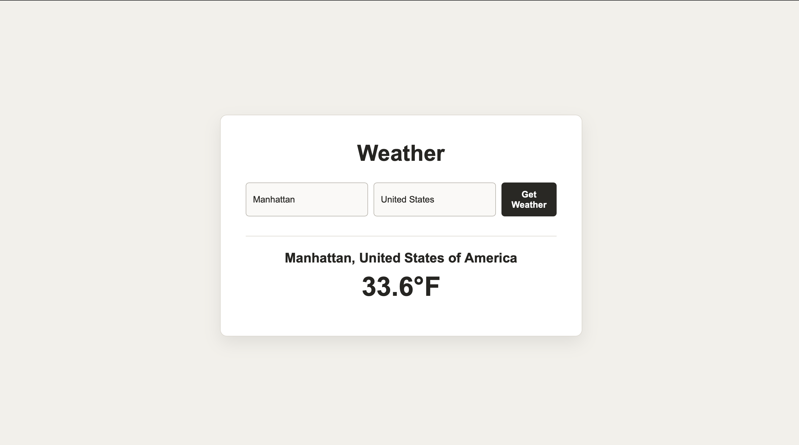

# Weather Lookup

**Local weather, one search away.**

Weather Lookup is a browser-based application that retrieves current temperature information for locations around the world.

Powered by WeatherAPI.com, the application allows users to search by city and country, returning the matching location and its current temperature in Fahrenheit through a clean, straightforward interface.

## Live Demo

[Explore Weather Lookup](https://weather-api-fun.netlify.app/)

## Application Preview



## Features

- **Location Search:** Enter a city and country to retrieve current weather information.
- **Live Weather Data:** Fetch temperature data from WeatherAPI.com.
- **Fahrenheit Display:** Present the current temperature in degrees Fahrenheit.
- **Location Identification:** Display the location name and country returned by the API.
- **Dynamic Results:** Update the interface with retrieved weather data without reloading the page.

## Tech Stack

| Technology | Purpose |
|------------|---------|
| HTML5 | Application structure and search interface |
| CSS3 | Styling, layout, and visual presentation |
| JavaScript | User interactions, API requests, and DOM updates |
| Fetch API | Asynchronous requests to the weather service |
| WeatherAPI.com | Current weather and location data |

## Technical Highlights

### Weather API Integration

The application uses JavaScript's Fetch API to request current weather information through WeatherAPI.com's `current.json` endpoint.

Users provide a city and country, which are combined into a location query and submitted to the API.

### URL-Safe Location Queries

The application uses JavaScript's `encodeURIComponent()` method to encode the location query before adding it to the request URL.

This helps ensure that spaces and other special characters in location names are formatted appropriately for the API request.

### Dynamic DOM Updates

When the API returns a weather response, the application accesses the relevant properties of the returned data object.

The location name, country, and temperature in Fahrenheit are then displayed directly in the interface without requiring a page reload.

### Event-Driven Interaction

A JavaScript click event listener triggers the weather lookup when users select **Get Weather**.

This connects user input, asynchronous API requests, and dynamic interface updates in a single interaction.

## Product Roadmap

The current implementation establishes the foundation for a more comprehensive weather experience.

Potential enhancements include:

- **Weather Conditions:** Display current conditions, descriptive labels, and weather icons.
- **Temperature Preferences:** Allow users to switch between Fahrenheit and Celsius.
- **Improved Search Experience:** Add input validation, loading indicators, and clear error messages.
- **Weather Forecasts:** Expand beyond current conditions to include daily and multi-day forecasts.
- **Saved Locations:** Allow users to quickly revisit frequently searched cities.
- **Enhanced Accessibility:** Improve keyboard interaction, screen-reader feedback, and mobile responsiveness.

These enhancements represent potential future development rather than features currently available.

## Getting Started

### Use the Live Application

Visit [Weather Lookup](https://weather-api-fun.netlify.app/), enter a city and country, and click **Get Weather** to retrieve the current temperature.

### Run Locally

1. Clone the repository's `answer` branch:

   ```bash
   git clone --branch answer --single-branch https://github.com/BuilderPlayground/weather-api-bootcamp.git
   ```

2. Navigate to the project directory:

   ```bash
   cd weather-api-bootcamp
   ```

3. Open the project in VS Code.

4. Launch `index.html` using Live Server.

5. Enter a city and country, then click **Get Weather**.

## Project Structure

```text
weather-api-bootcamp/
├── css/
│   ├── normalize.css
│   ├── reset.css
│   └── style.css
├── js/
│   └── main.js
├── index.html
├── weather-api-demo-pic.png
└── README.md
```

## Credits & Acknowledgments

Built using the [Resilient Labs starter repository](https://github.com/Resilient-Labs/weather-api-bootcamp).

Weather data is provided by [WeatherAPI.com](https://www.weatherapi.com/).
